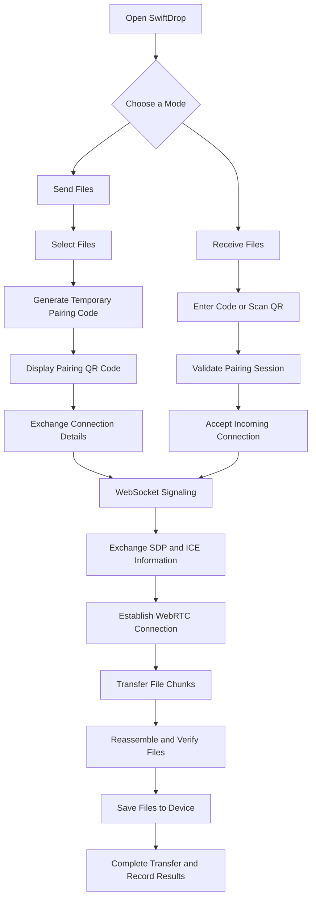

 <div align="center">

# SwiftDrop

### Direct Transfers. Maximum Performance. Complete Control.

A high-performance, privacy-focused device-to-device file transfer platform built around WebRTC, parallel data streams, intelligent compression, secure device pairing, and persistent transfer management.

<br/>

<!-- Replace these URLs with your actual live application and repository links. -->

<a href="https://github.com/tylonmademe-1/swiftdrop">
  
</a>

<a href="#getting-started">
  
</a>

<br/><br/>


<br/><br/>

**Built for moving files between devices — without relying on centralized cloud file storage.**

</div>

---

## 01 — Project Overview

SwiftDrop is a full-stack device-to-device file transfer platform designed to make transferring files between browsers fast, private, and straightforward.

The platform combines WebRTC DataChannels for file transport, WebSocket signaling for device coordination, and SQLite-backed persistence for account management, transfer history, device preferences, and security events.

From instant guest transfers to authenticated user dashboards, SwiftDrop brings together performance-oriented networking, file integrity verification, secure pairing, and transparent transfer management in one cohesive application.

<table>
<tr>
<td width="50%" valign="top">

**Direct File Transfer**

Exchange file data between connected devices using WebRTC DataChannels, with optional TURN relay support when direct connectivity is unavailable.

</td>
<td width="50%" valign="top">

**Transfer Acceleration**

Experiment with parallel DataChannels, configurable chunk sizes, streaming compression, and adaptive backpressure.

</td>
</tr>
<tr>
<td width="50%" valign="top">

**Secure User Accounts**

Manage authentication, active login sessions, saved devices, account preferences, and recovery workflows.

</td>
<td width="50%" valign="top">

**Transfer Intelligence**

Track transfer history, inspect activity, verify file integrity, monitor connection telemetry, and export transfer receipts.

</td>
</tr>
</table>

### Core Design Principles

- **Privacy by architecture** — Keep file contents out of the signaling backend.
- **Performance by design** — Use configurable transport strategies and efficient streaming.
- **Security by default** — Protect credentials, session tokens, and pairing workflows.
- **Control without complexity** — Provide straightforward sender, receiver, and account experiences.
- **Transparent operation** — Distinguish completed transfers, integrity verification, and confirmed file saving.

---

## 02 — Platform Showcase

<div align="center">

<!-- Add screenshots of the actual application when available. -->

<!--

-->

*Add a high-resolution screenshot of the SwiftDrop dashboard here.*

</div>

SwiftDrop is organized around three primary experiences:

- **Send:** Select files, create a temporary pairing session, and share a connection code or QR code.
- **Receive:** Connect using the sender's pairing code or QR code, approve the connection, and receive files.
- **Manage:** Review account activity, inspect transfer records, organize devices, and control privacy preferences.

<div align="center">

[**Explore the SwiftDrop Repository →**](https://github.com/tylonmademe-1/swiftdrop)

</div>

---

## 03 — Core Capabilities

### High-Performance Transfer Engine

SwiftDrop implements a configurable transport architecture inspired by parallel file-transfer systems such as bbcp and lftp.

| Capability | Description |
|---|---|
| Parallel DataChannels | Configurable 1×, 2×, 4×, or 8× channel configurations |
| Binary chunk framing | Magic identifier, chunk indexes, and packet metadata |
| Adaptive chunking | 64 KiB, 128 KiB, and 256 KiB chunk configurations |
| Backpressure | Buffered-amount monitoring to manage queued data |
| Chunk reassembly | Reconstruct files when chunks arrive out of order |
| Integrity verification | SHA-256 verification of transferred file contents |
| Network telemetry | Connection statistics, RTT, and active transport details |

Parallel channels allow chunks to be distributed across multiple DataChannels. The receiver uses chunk metadata to reconstruct the original file in the correct order.

Actual throughput depends on browser behavior, network capacity, CPU usage, congestion, and the selected connection path. Parallelization is an optimization strategy, not a guarantee of faster transfers.

### On-the-Fly Stream Compression

SwiftDrop uses browser-native streaming compression where supported.

- Uses `CompressionStream('gzip')` and `DecompressionStream('gzip')`.
- Targets compressible content such as source code, JSON, CSV, logs, and text documents.
- Skips formats that are already compressed when compression is unlikely to help.
- Supports streaming processing instead of requiring the entire file to be buffered.
- Preserves original file contents through decompression and integrity verification.

Compression ratios vary with file content. JPEG, PNG, MP4, ZIP, and similar formats typically offer limited additional compression.

### Direct LAN Connectivity

When network conditions permit, SwiftDrop establishes direct peer-to-peer connections between devices.

- ICE candidate inspection for connectivity diagnostics.
- Support for local-network connections where browser and network policies permit.
- WebRTC connection statistics for monitoring active sessions.
- RTT and connection-type reporting.
- Optional TURN relay fallback for restrictive networks.

A local IP address alone does not prove that file traffic uses a direct LAN route. Connection classification should be based on the selected ICE candidate pair and relevant connection statistics.

### Flexible File Saving

SwiftDrop distinguishes receiving file data from saving it to persistent storage.

- File System Access API integration where supported.
- Standard browser download fallback.
- Multi-file transfer support.
- Per-file transfer progress and completion states.
- SHA-256 integrity results.
- Saved-to-disk status when it can be reliably confirmed.

---

## 04 — Sender, Receiver & Pairing Workflow

SwiftDrop uses temporary transfer sessions to connect sender and receiver devices.



### Sender Experience

1. Open the Send interface.
2. Select one or more files.
3. Generate a temporary pairing session.
4. Share the pairing code or display its corresponding QR code.
5. Wait for the receiver to connect and complete the required approval steps.
6. Transfer files while monitoring progress.
7. Review the completion status and available integrity results.

### Receiver Experience

1. Open the Receive interface.
2. Choose pairing-code entry or QR scanning.
3. Submit the sender's temporary connection code.
4. Validate the pairing session and accept the incoming connection where required.
5. Complete WebRTC connection negotiation.
6. Receive and reassemble file chunks.
7. Verify file integrity and save the files using the available browser mechanism.

### Pairing and Session Security

Temporary pairing codes should be unpredictable, short-lived, rate-limited, and invalidated after use or expiration according to the session policy. The server must authorize both participants before exchanging connection information.

Pairing sessions, saved device shortcuts, and authenticated login sessions are separate concepts and should have independent lifecycles.

---

## 05 — Architecture & Networking

SwiftDrop separates application logic, signaling, persistent storage, and file transport.

```text
┌──────────────────────────────────────────┐
│             SwiftDrop Frontend            │
│                                          │
│  Sender UI · Receiver UI · Dashboard     │
│  Device Management · Transfer History    │
└───────────────────┬──────────────────────┘
                    │
             HTTPS / WSS
                    │
┌───────────────────▼──────────────────────┐
│              Node.js Backend              │
│                                          │
│  Express API       WebSocket Signaling   │
│  Authentication    Pairing Coordination │
│  Session Security  TURN Credential API  │
└───────────────────┬──────────────────────┘
                    │
              SQLite Database
                    │
         Users · Sessions · Transfers
         Devices · Preferences · Audit

                WebRTC ICE
                    │
          ┌─────────┴─────────┐
          │                   │
     Sender Device       Receiver Device
          │                   │
          └──── DataChannels ─┘

           Optional TURN Relay
```

### Technology Stack

| Layer | Technology |
|---|---|
| Frontend | Vite-based web application |
| Backend | Node.js and Express |
| Signaling | WebSocket |
| File transport | WebRTC DataChannels |
| Transport security | DTLS through WebRTC |
| Connectivity | ICE with STUN/TURN |
| Persistent storage | SQLite |
| Database API | Node.js `node:sqlite` |
| Authentication | Scrypt password hashing and secure session cookies |
| Integrity verification | SHA-256 |
| Stream compression | Compression Streams API |

### Transport Model

WebRTC DataChannels use SCTP over DTLS, with ICE establishing connectivity. WebRTC is not equivalent to opening arbitrary raw UDP sockets from browser JavaScript.

The signaling server exchanges connection-negotiation data, including SDP and ICE candidates. It does not need to receive the actual file bytes.

When a direct path is unavailable, an appropriately configured TURN relay can forward the encrypted WebRTC traffic.

---

## 06 — Database & Persistent Storage

SwiftDrop uses SQLite for account data, session state, transfer metadata, and user preferences.

**Database location:** `data/swiftdrop.db`

The database configuration uses Write-Ahead Logging (WAL), foreign-key enforcement, and an explicitly configured synchronization policy.

| Table | Responsibility |
|---|---|
| `users` | User identity, normalized email, password hash, and timestamps |
| `auth_sessions` | Hashed login tokens, activity timestamps, and revocation status |
| `transfers` | Direction, status, byte counts, timestamps, and device labels |
| `transfer_files` | File names, sizes, MIME types, integrity results, and save status |
| `user_preferences` | Theme, history recording, and default device preferences |
| `devices` | Saved device labels and last-seen activity |
| `password_reset_tokens` | Hashed, single-use recovery tokens with expiration |
| `audit_events` | Security-sensitive account and authentication events |

### Personal Dashboard

The dashboard derives account metrics from persisted transfer records.

- Total completed transfers.
- Total bytes sent.
- Total bytes received.
- Failed, cancelled, and incomplete transfers.
- Recent activity and transfer details.

### Transfer History

The history interface supports:

- Direction filters: `All`, `Sent`, `Received`.
- Status filters: `All`, `Completed`, `Failed`, `Cancelled`.
- Filename and device-label search.
- Pagination.
- Individual record deletion.
- Clear-history actions.

When history recording is disabled, the application should avoid persisting new transfer-history records according to the user's preference, while retaining any records and security data that must be managed separately under the application's policies.

### Transfer Receipts

SwiftDrop supports downloadable JSON receipt records containing available transfer metadata.

```json
{
  "transferId": "example-transfer-id",
  "direction": "sent",
  "status": "completed",
  "completedAt": "2026-10-21T12:00:00.000Z",
  "files": [
    {
      "name": "example.pdf",
      "size": 1048576,
      "sha256Verified": true,
      "saved": true
    }
  ],
  "transport": {
    "type": "webrtc",
    "encrypted": true
  }
}
```

*Illustrative receipt schema only. Actual field names and values depend on the implemented receipt format.*

Receipts record reported transfer outcomes. They are not proof of sender identity unless a separate digital-signature mechanism is implemented.

---

## 07 — Authentication & Privacy

SwiftDrop includes an account and session model designed to protect user credentials and persistent application data.

### Authentication

- Scrypt password hashing with cryptographically random salts.
- HTTP-only session cookies.
- Hashed session-token storage.
- Session rotation, expiration, and revocation.
- Single-use password recovery tokens.
- Password verification before sensitive account operations.
- Audit events for relevant authentication and account actions.

### Device Management

Saved device labels help users identify familiar devices, for example:

- Work Laptop
- Personal Desktop
- Living Room TV

Saved device shortcuts are organizational metadata; they do not automatically represent verified hardware identities.

### Privacy Controls

- Enable or disable future transfer-history recording.
- Export account profile, preferences, devices, and transfer metadata.
- Review and revoke active login sessions.
- Delete individual transfer records.
- Permanently delete an account after the required verification steps.

### Security Considerations

Production deployments should enforce HTTPS/WSS, validate all input, rate-limit authentication and pairing endpoints, authorize session access, configure secure cookies, and protect against cross-site request forgery where applicable.

TURN credentials should be short-lived where supported and must not expose long-lived server secrets to browser bundles. Database files and backups must remain outside public web directories.

---

## 08 — Getting Started

### Requirements

- Node.js 22 or later for the stated native `node:sqlite` implementation.
- npm.
- Git.
- A modern browser with WebRTC support.

### Clone the Repository

```bash
git clone https://github.com/tylonmademe-1/swiftdrop.git

cd swiftdrop
```

Replace the repository URL if your actual repository uses a different owner or name.

### Install Dependencies

```bash
npm install
```

### Configure Environment Variables

Create a `.env` file using the variables supported by the application.

```dotenv
PORT=3000
APP_URL=http://localhost:3000

# Optional TURN configuration
TURN_SERVER_URL=
TURN_USERNAME=
TURN_CREDENTIAL=
```

Never commit production credentials to version control.

### Start Development

```bash
npm run dev
```

Open the configured local URL, typically:

`http://localhost:3000`

The development server should initialize the Express backend, SQLite integration, WebSocket signaling, and Vite middleware according to the project scripts.

### Build for Production

```bash
npm run build

npm start
```

---

## 09 — Local Network Deployment

SwiftDrop can be configured for devices connected to the same Wi-Fi or local network.

### Configure the Host

Find the host computer's LAN address. For example:

```dotenv
PORT=3000
LAN_IP=192.168.1.3
APP_URL=http://192.168.1.3:3000
```

Use your actual LAN address rather than the example value.

### Start the Application

```bash
npm run dev
```

Ensure the server listens on an interface reachable by other devices and that the firewall allows the required connections.

### Connect Other Devices

Open the configured URL on the sender and receiver devices. Create a pairing session, scan the QR code or enter the pairing code, and complete the connection workflow.

**Browser compatibility:** Some APIs require a secure context. `localhost` is generally treated as secure, but a plain HTTP LAN address may not provide access to every browser API. Configure HTTPS when required.

---

## 10 — Production Deployment & TURN

### HTTPS and WebSocket Security

Production deployments should use HTTPS and WSS, with an appropriately configured reverse proxy or hosting environment.

Recommended operational controls:

- Strong session and cookie settings.
- Rate limits for login, registration, recovery, and pairing.
- WebSocket message validation and connection limits.
- Authorization checks on all account-specific API routes.
- Secure secret management.
- Privacy-conscious logging.
- Database backups and restore testing.
- Dependency and vulnerability monitoring.

### TURN Relay Setup

For restrictive NAT environments and firewalls, configure a TURN server such as Coturn.

```dotenv
TURN_SERVER_URL=turn:turn.example.com:3478
TURN_USERNAME=your-turn-username
TURN_CREDENTIAL=your-turn-credential
```

The backend should issue appropriate credentials to authorized transfer sessions without exposing static long-lived TURN credentials in client-side code.

Direct connectivity and relay availability depend on the deployment's ICE configuration, firewall rules, and network conditions.

---

## 11 — Database Durability & Recovery

SQLite WAL mode supports concurrent readers and a writer, subject to SQLite's locking and durability behavior. Choose the synchronization configuration according to the application's data-loss and performance requirements.

### Online Backup

With the SQLite command-line utility installed:

```bash
sqlite3 data/swiftdrop.db \
  ".backup 'data/backup-$(date +%F).db'"
```

### Restore a Backup

Stop the application first and preserve a copy of the existing database.

```bash
sqlite3 data/swiftdrop.db \
  ".restore 'data/backup-target.db'"
```

Verify that the installed SQLite CLI supports the chosen command syntax. Alternatively, restore to a separate database file and replace the active database while the application is stopped.

### Integrity Check

```bash
sqlite3 data/swiftdrop.db \
  "PRAGMA integrity_check;"
```

Expected successful output:

```text
ok
```

Use SQLite's backup functionality or another WAL-aware backup procedure rather than copying only the main database file while active WAL state may contain uncheckpointed changes.

---

## 12 — Testing & Verification

SwiftDrop's documented test plan covers the major transfer, authentication, and persistence workflows.

| Test Suite | Coverage |
|---|---|
| `e2e_transfer.test.ts` | Pairing, QR parsing, session state, chunk assembly, and integrity checks |
| `sessions.test.ts` | Pairing-code expiry, rate limiting, and reuse prevention |
| `framing.test.ts` | Binary packet framing, byte formatting, and speed calculations |
| `auth_db.test.ts` | Registration, login, migrations, authorization, metrics, and export |
| `acceleration.test.ts` | Parallel channel distribution and out-of-order reassembly |
| `compression.test.ts` | Streaming compression and decompression fidelity |

### Run the Test Suite

```bash
npm test
```

The documented suite contains six test files and 30 tests. Verify the actual test count and passing results against the current repository before publishing those numbers as release guarantees.

### Recommended Verification Areas

- Pairing between separate devices and browsers.
- Expired, invalid, and reused pairing codes.
- Interrupted connections and incomplete transfers.
- Large-file streaming and memory usage.
- Out-of-order chunk reconstruction.
- SHA-256 verification after receipt.
- Compression round-trip fidelity.
- Session expiration and revocation.
- SQLite migrations and account isolation.
- File saving across supported browsers.

---

## 13 — Project Structure

A representative structure for organizing SwiftDrop's application code:

```text
swiftdrop/
├── src/
│   ├── client/                 # Web interface
│   ├── server/                 # Express API and signaling
│   ├── transfer/               # WebRTC and file transport
│   ├── auth/                   # Authentication and sessions
│   └── shared/                 # Shared types and protocol definitions
├── tests/
│   ├── e2e_transfer.test.ts
│   ├── sessions.test.ts
│   ├── framing.test.ts
│   ├── auth_db.test.ts
│   ├── acceleration.test.ts
│   └── compression.test.ts
├── data/                       # Persistent SQLite database
├── public/                     # Static public assets
├── .env.example
├── package.json
└── README.md
```

This layout is illustrative. Keep the final documentation synchronized with the actual directory structure and file names in the repository.

---

## 14 — Roadmap

Potential areas for continued development:

- [ ] Adaptive channel configuration based on measured network performance.
- [ ] Resumable transfers after temporary connection failures.
- [ ] Improved mobile browser and device compatibility.
- [ ] Enhanced transfer queue management and cancellation.
- [ ] Stronger automated network-failure testing.
- [ ] Automated backup retention and restore verification.
- [ ] Expanded security auditing and integration tests.
- [ ] Improved accessibility and keyboard navigation.
- [ ] Performance benchmarking across LAN and WAN environments.

*Roadmap items represent potential improvements and should not be interpreted as already implemented features.*

---

## 15 — Contributing

Contributions, bug reports, and performance improvements are welcome.

1. Fork the repository.
2. Create a dedicated feature branch.
3. Implement the change and add relevant tests.
4. Run the test suite.
5. Submit a pull request with a clear explanation of the implementation and verification.

For bug reports, include the browser, operating system, reproduction steps, and relevant non-sensitive logs.

Do not include passwords, session tokens, TURN credentials, or private transfer data in issues.

---

## 16 — License

SwiftDrop is intended to be distributed under the **MIT License**.

See [`LICENSE`](LICENSE) for the complete license terms. Ensure the repository contains the appropriate license file before publishing this claim.

---

<div align="center">

### SwiftDrop

**Move files directly. Transfer intelligently. Stay in control.**

<br/>

[View Source](https://github.com/tylonmademe-1/swiftdrop) · [Getting Started](#getting-started) · [Deployment](#production-deployment--turn)

<br/>

<sub>Built for fast, private, device-to-device file transfers.</sub>

</div>
